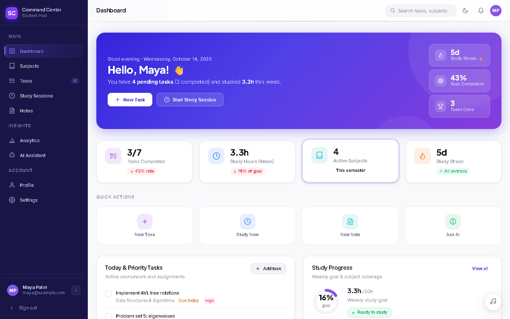
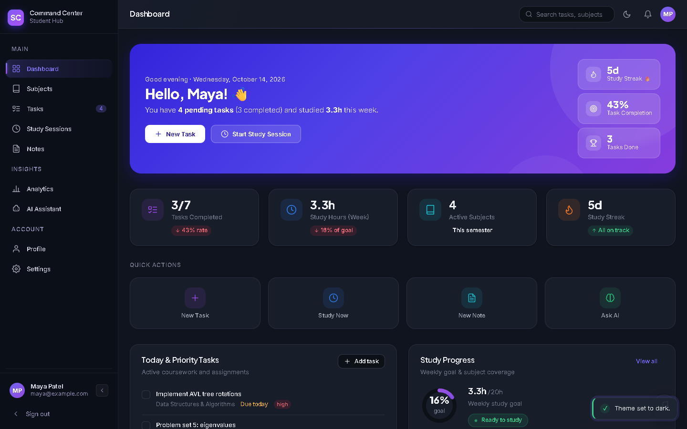
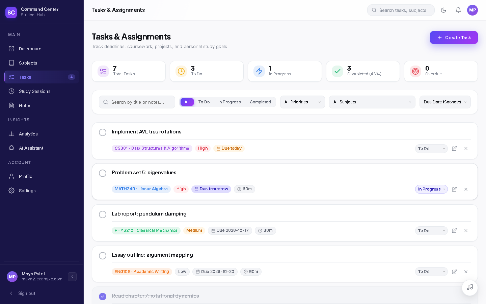
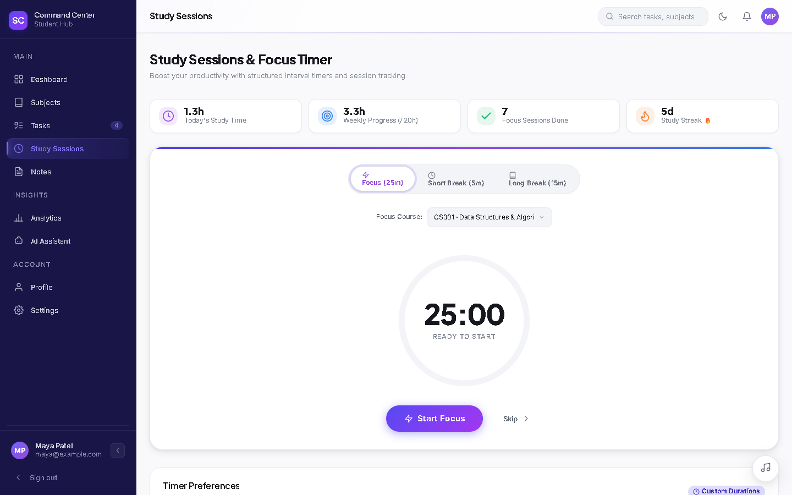
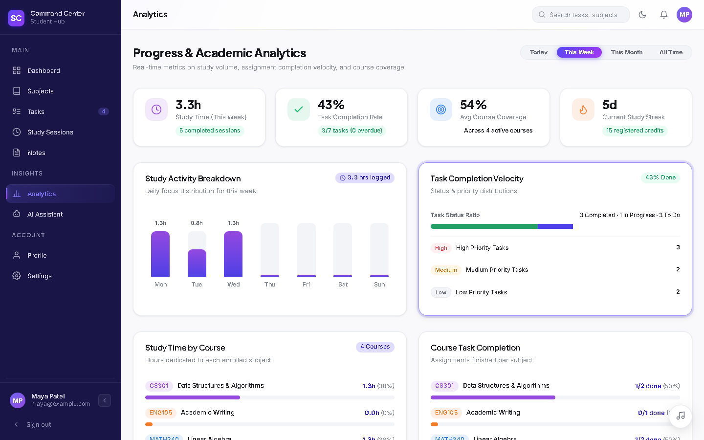
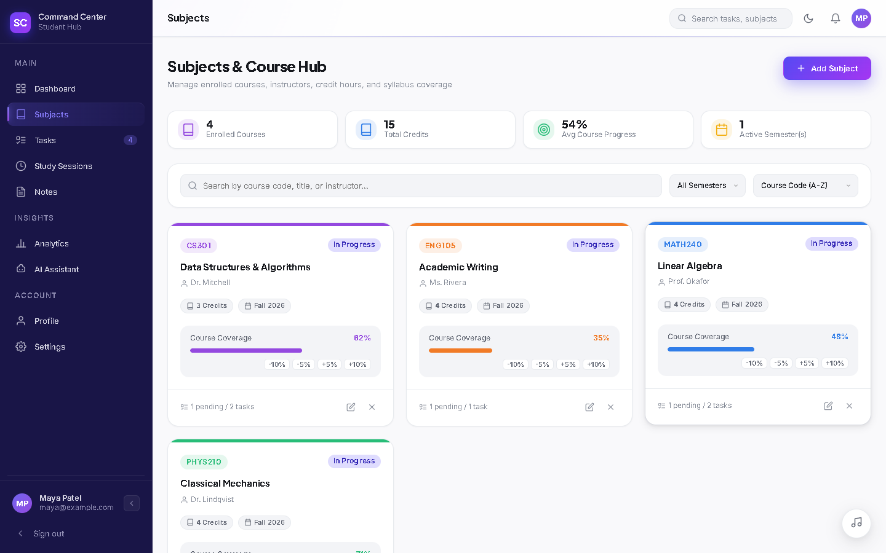
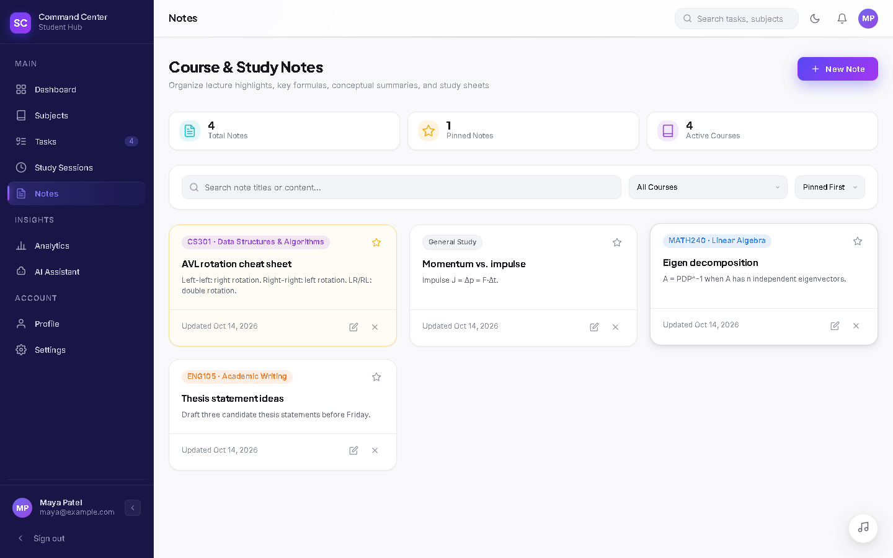
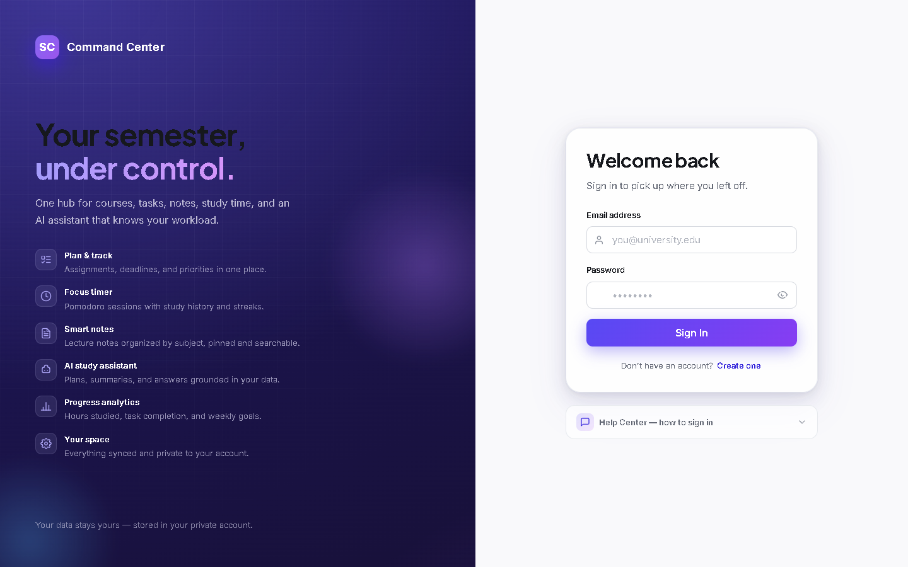
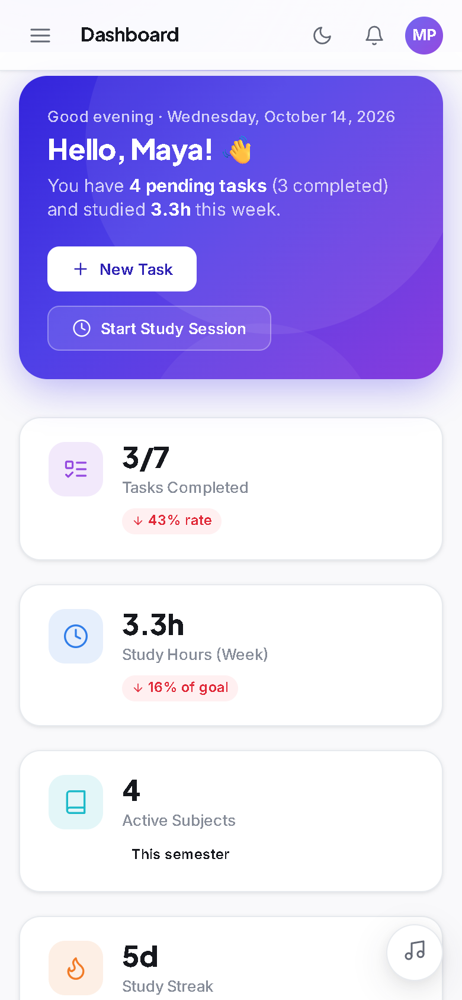
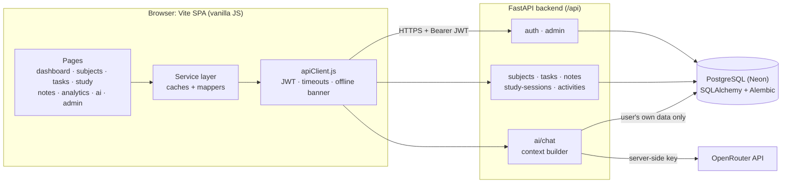

<p align="center"></p>

<p align="center">
  
  
  
  
  
  
  <a href="https://student-command-center-ruddy.vercel.app"></a>
</p>

<p align="center">
  
</p>

## What it is

**Student Command Center** is a personal study hub: courses, assignments, lecture notes, a Pomodoro focus timer,
progress analytics and an AI study assistant in one place, with every record private to the signed-in student.
New accounts go through an admin approval queue, and admins get a separate management console.

<p align="center"></p>

## Features

| | Feature | What you get |
|---|---|---|
| 🏠 | **Dashboard** | Greeting, pending/completed task counts, weekly study hours, streak, quick actions, priority tasks and upcoming deadlines |
| 📚 | **Subjects** | Course code, title, instructor, credits, semester, colour, progress and grade; search, semester filter and sorting |
| ✅ | **Tasks** | Priority, status (to do / in progress / completed), due date, estimate; "due today / tomorrow / overdue" tags, filters and sorting |
| ⏱️ | **Focus timer** | Focus / short break / long break sessions with custom durations, per-course tracking, session history and day streaks |
| 📝 | **Notes** | Notes per subject (or general), pinning, search, sorting |
| 📊 | **Analytics** | Today / week / month / all-time views: study time per day and per course, task completion and priority breakdown |
| 🤖 | **AI study assistant** | Chat grounded in *your own* tasks, subjects, sessions and notes (server-side OpenRouter call, per-user rate limit) |
| 👤 | **Profile & Settings** | Profile editing, password change, light/dark/system theme, weekly goal, timer defaults, JSON export |
| 🛡️ | **Admin console** | Approve / reject sign-ups, edit, reset password, delete users, manage roles, login activity |
| 🎧 | **Ambient music** | Optional background study track with a floating player |
| 🔐 | **Security** | bcrypt passwords, JWT with server-side revocation on logout, per-user data isolation, login + AI rate limits, security headers |

## Screenshots

| Dashboard | Dashboard (dark) |
|---|---|
|  |  |
| **Tasks** | **Focus timer** |
|  |  |
| **Analytics** | **Subjects** |
|  |  |
| **Notes** | **Sign in** |
|  |  |

<p align="center"></p>

<sub>All screenshots use fake demo data (demo student "Maya Patel").</sub>

## Architecture



**Sign-up flow:** register → account is *pending* → an admin approves it in the console → the student can sign in.

## Quickstart

**Prerequisites:** Node.js 20+, Python 3.12+, a PostgreSQL database (e.g. a free [Neon](https://neon.tech) project).

```bash
git clone https://github.com/ekupekuAI/student-command-center.git
cd student-command-center
```

**1. Backend**

```bash
cd backend
python -m venv .venv
.venv\Scripts\activate          # macOS/Linux: source .venv/bin/activate
pip install -r requirements.txt
copy .env.example .env          # macOS/Linux: cp .env.example .env, then fill in the values
alembic upgrade head
uvicorn app.main:app --reload --port 8000
```

Set `ADMIN_EMAIL` / `ADMIN_PASSWORD` in `backend/.env` so an admin account exists to approve new sign-ups.

**2. Frontend** (new terminal, repo root)

```bash
npm install
npm run dev
```

Open http://localhost:5173, create an account, approve it from the admin account, then sign in.

**Tests & build**

```bash
cd backend && python -m pytest -q   # in-memory SQLite + mocked AI, no network needed
npm run build                        # frontend → dist/
```

## Environment variables

### Backend: `backend/.env` (template: [`backend/.env.example`](backend/.env.example))

| Variable | Required? | Where to get it / notes |
|---|---|---|
| `DATABASE_URL` | **Yes** | PostgreSQL connection string, e.g. from the [Neon console](https://console.neon.tech) → *Connection string* (psycopg 3 driver). |
| `JWT_SECRET` | **Yes** (production) | Generate: `python -c "import secrets; print(secrets.token_urlsafe(48))"`. The app refuses to start in production with the dev placeholder. |
| `ENVIRONMENT` | Yes | `development` or `production` (production disables `/docs` and adds HSTS). |
| `CORS_ORIGINS` | Yes | Comma-separated frontend origins, e.g. `https://your-app.vercel.app`. (`CORS_ORIGINS_RAW` is the primary name; `CORS_ORIGINS` is accepted as an alias.) |
| `ADMIN_EMAIL`, `ADMIN_PASSWORD` | Recommended | Seeds the admin account at startup so sign-ups can be approved. Choose your own and never commit them. `ADMIN_NAME` is optional. |
| `OPENROUTER_API_KEY` | No | [openrouter.ai/keys](https://openrouter.ai/keys). Without it the AI chat shows "not configured"; everything else works. |
| `OPENROUTER_MODEL` | No | Model id. Code default `openrouter/auto`; the template uses `openrouter/free`. |
| `OPENROUTER_BASE_URL`, `APP_SITE_URL`, `APP_NAME` | No | Provider base URL, public site URL (sent as `HTTP-Referer`), API display name. |
| `ACCESS_TOKEN_EXPIRE_MINUTES` | No | JWT lifetime (default 10080 = 7 days). |
| `AI_REQUEST_TIMEOUT_SECONDS`, `AI_MAX_OUTPUT_TOKENS`, `AI_HISTORY_LIMIT`, `AI_CONTEXT_BUDGET_CHARS` | No | AI cost/behaviour guardrails (defaults 45 / 700 / 12 / 6000). |
| `AI_RATE_LIMIT_PER_MINUTE`, `AUTH_RATE_LIMIT_PER_MINUTE` | No | Per-user AI and per-IP login/register limits (defaults 20 / 60). |
| `DEV_USER_EMAIL`, `DEV_USER_PASSWORD` | Migration only | Only when running `alembic upgrade` on a database that already holds pre-auth data. |

### Frontend: `.env` (template: [`.env.example`](.env.example))

| Variable | Required? | Notes |
|---|---|---|
| `VITE_API_BASE_URL` | No (defaults to `http://127.0.0.1:8000/api`) | Your deployed backend URL + `/api`; set at build time (e.g. in Vercel project settings). |

<details>
<summary><strong>Project structure</strong></summary>

```text
student-command-center/
├── index.html                 # SPA entry
├── src/
│   ├── app.js                 # auth gate, router setup, warm-up
│   ├── shell.js, router.js    # layout + hash router
│   ├── pages/                 # dashboard, subjects, tasks, study, notes, analytics, ai, profile, settings, admin, auth
│   ├── components/            # task / subject / note modals
│   ├── services/              # apiClient, per-entity services, mappers, dates, music, migration
│   └── styles/                # tokens, base, layout, components, pages, auth
├── public/                    # favicon, icons, ambient audio
├── backend/
│   ├── app/
│   │   ├── core/              # settings, security (bcrypt/JWT), rate limiting
│   │   ├── models/ schemas/   # SQLAlchemy models + Pydantic schemas
│   │   ├── routers/           # auth, admin, subjects, tasks, notes, study, activities, ai, health
│   │   └── services/          # auth, activity log, AI client, context builder
│   ├── alembic/               # migrations
│   ├── tests/                 # pytest suite
│   └── railway.json, Procfile # backend deployment
├── vercel.json                # frontend deployment
└── docs/readme/               # README banner, screenshots, walkthrough
```
</details>

## Deployment

- **Frontend → Vercel:** `vercel.json` builds with `npm run build` and serves `dist/`. Set `VITE_API_BASE_URL`.
- **Backend → Railway** (or any host): `backend/railway.json` / `Procfile` run `uvicorn app.main:app --host 0.0.0.0 --port $PORT` with health check `/api/health`. Set the backend variables above with `ENVIRONMENT=production`.
- **Database:** run `alembic upgrade head` against your production database.

## What's new in this version

| Area | Before | After |
|---|---|---|
| **Tasks page** | Crashed on open (`subjects is not defined`) and rendered blank | Renders normally, with a working subject filter |
| **Dates & deadlines** | "Today" came from UTC. In India before 05:30 IST, tasks due today showed as tomorrow, overdue counts were off and study streaks broke | Every today/tomorrow/overdue, streak, analytics-range and default-due-date check uses the student's local calendar day |
| **Saving forms** | A failed task create/edit or subject edit closed the dialog silently and lost the input | The dialog waits for the server, shows the error and stays open |
| **AI chat** | Each new message was sent twice (once inside the history) | Sent once |
| **Focus timer** | After its subject was deleted, the timer kept the old id and the session save was rejected | It picks a valid subject automatically |
| **Sign out** | Landed on the *Create account* form | Lands on *Sign in* |
| **Avatar** | Header/sidebar always showed "SC" | Shows the student's initials |
| **Help Center** | Said new accounts are "signed in automatically" | Explains the admin-approval step |
| **Upcoming tasks** | Sorting crashed on a task without a due date | Handles missing due dates |
| **README** | Text-only | Animated banner, screenshots, walkthrough, architecture diagram, env table |

## Future development

- Admins who open the avatar/Profile link see the admin console under a "Profile" heading (no admin profile page yet).
- The activity feed only refreshes after subject changes on the next load.
- The Profile page counts break sessions in total study time, while the dashboard and analytics count focus sessions only.
- `PATCH` endpoints return 500 instead of 422 when a client sends `null` for a required field (the app itself never does).
- The rate limiter is in-memory, so it needs a shared store (e.g. Redis) before running several backend workers.

## Security notes

- Secrets live only in git-ignored `.env` files. Never commit `DATABASE_URL`, `JWT_SECRET`, `OPENROUTER_API_KEY` or passwords.
- Every user-owned query is scoped by `user_id`, and tests check that one user can't read or change another user's data.
- Error responses never leak provider internals, credentials or exception text.
